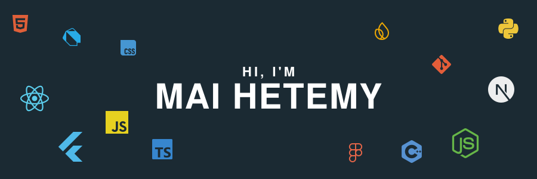

## About

Computer Science graduate (Suez Canal University, 2024) based in Port Said, Egypt.
I build web and mobile apps with React, Next.js, and Flutter, and I'm growing my backend skills with Node.js.

- 🚀 Co-founder of [ScaleVia](https://www.scalevia.net/ar), a web agency building websites with React and Next.js
- 🎓 Programming instructor since 2024: Web Development and Python (E-Youth), Flutter and Dart (3C)
- 📚 Learning Full-Stack development (React & Node.js) at Route Academy
- 🧮 1000+ problems solved on LeetCode, Codeforces, and HackerRank

## Skills

**Frontend** 
 

**Mobile** 
 

**Backend** 
 

**Tools** 

📫 **Open to Full-Stack / Node.js opportunities.** Reach me at [maihetemy@gmail.com](mailto:maihetemy@gmail.com)
